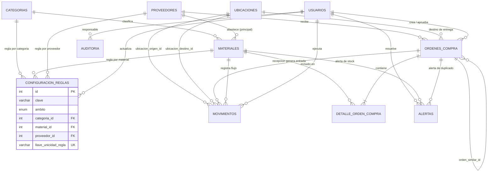

# Modelo Entidad-Relación Actualizado — Gestion_inventory (Fase 0 Corregida)

## 1. Propósito y Alcance del Modelo de Datos

El modelo de datos de **Gestion_inventory** para la organización `EMPRESA_FICTICIA_PENDIENTE` está diseñado sobre **MySQL 8.0** utilizando el motor transaccional `InnoDB`, juego de caracteres `utf8mb4` y colación `utf8mb4_unicode_ci`. Todos los importes monetarios están expresados en **colones costarricenses (`CRC`, `₡`)**.

El modelo consta de **12 tablas** organizadas para garantizar:

1. **Fuente única de verdad del inventario**: Las existencias actuales por ubicación y globales se calculan exclusivamente mediante agregación de la tabla `movimientos`. Los campos de stock anterior y posterior en `movimientos` son únicamente instantáneas (*snapshots*) para auditoría histórica.
2. **Parametrización centralizada**: Incorporación de la tabla `configuracion_reglas` para administrar umbrales de aprobación en `CRC`, tolerancias de órdenes duplicadas, parámetros de alertas y tiempos de recuperación de eventos sin valores fijos en el código.
3. **Integridad referencial y de dominio**: Claves primarias (`PRIMARY KEY`), claves foráneas (`FOREIGN KEY`) con política de conservación histórica (`ON DELETE RESTRICT`), restricciones `UNIQUE` y validaciones `CHECK`.
4. **Fiabilidad asíncrona con n8n**: Soporte completo para el patrón *Transactional Outbox* con reclamación atómica (`PROCESSING`), control de bloqueo temporal (`locked_at`) y recuperación ante interrupciones.

---

## 2. Diagrama Entidad-Relación (12 Tablas)



---

## 3. Orden de Creación de Tablas y Resolución de Dependencias

Para evitar errores de claves foráneas durante la creación del esquema, las **12 tablas** deben crearse siguiendo este orden topológico:

| Orden | Tabla | Dependencias (`FOREIGN KEY`) | Justificación |
| :---: | :--- | :--- | :--- |
| **1** | `usuarios` | Ninguna | Entidad base requerida por auditoría, reglas, órdenes, movimientos y alertas. |
| **2** | `categorias` | Ninguna | Catálogo maestro independiente para clasificar materiales y reglas. |
| **3** | `proveedores` | Ninguna | Catálogo maestro independiente para abastecimiento, compras y reglas. |
| **4** | `ubicaciones` | Ninguna | Catálogo maestro de almacenes y frentes de obra. |
| **5** | `materiales` | `categorias(id)`, `proveedores(id)` | Requiere que existan categorías y proveedores. |
| **6** | `configuracion_reglas` | `categorias(id)`, `materiales(id)`, `proveedores(id)`, `usuarios(id)` | Se crea después de categorías, proveedores, materiales y usuarios para garantizar integridad referencial real mediante claves foráneas explícitas por ámbito. |
| **7** | `ordenes_compra` | `proveedores(id)`, `ubicaciones(id)`, `usuarios(id)`, `ordenes_compra(id)` | Requiere proveedores, ubicaciones y usuarios. Incluye autorreferencia nullable `orden_similar_id` resuelta en la misma definición de tabla. |
| **8** | `detalle_orden_compra` | `ordenes_compra(id)`, `materiales(id)` | Depende de la cabecera de orden de compra y del catálogo de materiales. |
| **9** | `movimientos` | `materiales(id)`, `ubicaciones(id)`, `ordenes_compra(id)`, `detalle_orden_compra(id)`, `usuarios(id)` | Se crea **después** de `ordenes_compra` y `detalle_orden_compra` para vincular las entradas generadas por recepciones parciales o totales a nivel de cabecera y renglón sin dependencia circular. |
| **10** | `eventos_integracion` | Ninguna (referencia polimórfica lógica) | Cola Outbox desacoplada; se crea antes de `alertas` para permitir vincular incidentes de workflow. |
| **11** | `alertas` | `materiales(id)`, `ordenes_compra(id)`, `eventos_integracion(id)`, `usuarios(id)` | Depende de materiales, órdenes de compra, eventos de integración y usuarios. |
| **12** | `auditoria` | `usuarios(id)` (nullable) | Bitácora histórica transversal de todas las operaciones. |

### Análisis de Dependencias Circulares
- **Relación entre `ordenes_compra` y `movimientos`**: Una recepción de orden de compra genera uno o más registros en `movimientos` de tipo `ENTRADA`. Por tanto, `movimientos` tiene la clave foránea `orden_compra_id` hacia `ordenes_compra(id)`, pero `ordenes_compra` **no** tiene clave foránea hacia `movimientos`. Esto evita cualquier dependencia circular.
- **Autorreferencia en `ordenes_compra`**: El campo `orden_similar_id` (`INT UNSIGNED NULL`) referencia a `ordenes_compra(id)` para señalar la orden previa con la que existe sospecha de duplicidad. Al ser anulable (`NULL`) y apuntar siempre a una orden creada con anterioridad, MySQL 8.0 permite declararla directamente en el `CREATE TABLE` sin conflicto.

---

## 4. Especificación Detallada de las 12 Tablas

### 4.1. Tabla `usuarios`
Almacena las cuentas de usuario, su rol RBAC y estado de acceso.

| Columna | Tipo | Nulo | Clave / Restricción | Descripción |
| :--- | :--- | :--- | :--- | :--- |
| `id` | `INT UNSIGNED` | No | `PK`, `AUTO_INCREMENT` | Identificador único del usuario |
| `nombre` | `VARCHAR(120)` | No | | Nombre completo del usuario |
| `email` | `VARCHAR(120)` | No | `UNIQUE` (`uk_usuarios_email`) | Correo electrónico de autenticación |
| `password_hash` | `VARCHAR(255)` | No | | Hash seguro de contraseña (`PBKDF2-SHA512`) |
| `rol` | `ENUM` | No | `'ADMINISTRADOR'`, `'ENCARGADO_INVENTARIO'`, `'COMPRAS'`, `'CONSULTA'` | Rol para control de permisos |
| `requiere_cambio_clave` | `TINYINT(1)` | No | `DEFAULT 1`, `CHECK (requiere_cambio_clave IN (0, 1))` | Indica si debe cambiar su clave al iniciar sesión (por defecto `1` en cuentas recién creadas) |
| `activo` | `TINYINT(1)` | No | `DEFAULT 1`, `CHECK (activo IN (0, 1))` | Si es `0`, bloquea inmediatamente el acceso |
| `ultimo_acceso` | `DATETIME` | Sí | | Fecha y hora del último inicio de sesión válido |
| `created_at` | `DATETIME` | No | `DEFAULT CURRENT_TIMESTAMP` | Fecha de alta |
| `updated_at` | `DATETIME` | No | `DEFAULT CURRENT_TIMESTAMP ON UPDATE CURRENT_TIMESTAMP` | Fecha de última modificación |

### 4.2. Tabla `configuracion_reglas` (Integridad Referencial por Ámbito)
Permite parametrizar las reglas de negocio del sistema tanto a nivel global como específico por entidad (`CATEGORIA`, `MATERIAL`, `PROVEEDOR`). Dado que MySQL 8.0 no soporta claves foráneas polimórficas sobre una única columna entera, se utilizan tres claves foráneas explícitas anulables (`categoria_id`, `material_id`, `proveedor_id`) controladas por una restricción `CHECK` de exclusión mutua según `ambito` y una columna generada `llave_unicidad_regla` con índice `UNIQUE`.

| Columna | Tipo | Nulo | Clave / Restricción | Descripción |
| :--- | :--- | :--- | :--- | :--- |
| `id` | `INT UNSIGNED` | No | `PK`, `AUTO_INCREMENT` | Identificador único de la regla |
| `clave` | `VARCHAR(80)` | No | | Identificador técnico (ej. `APROBACION_NIVEL_1_MAX`) |
| `ambito` | `ENUM` | No | `'GLOBAL'`, `'CATEGORIA'`, `'MATERIAL'`, `'PROVEEDOR'` | Nivel de aplicación de la regla |
| `categoria_id` | `INT UNSIGNED` | Sí | `FK -> categorias(id)` (`ON DELETE RESTRICT`) | Requerido exclusivamente cuando `ambito = 'CATEGORIA'` |
| `material_id` | `INT UNSIGNED` | Sí | `FK -> materiales(id)` (`ON DELETE RESTRICT`) | Requerido exclusivamente cuando `ambito = 'MATERIAL'` |
| `proveedor_id` | `INT UNSIGNED` | Sí | `FK -> proveedores(id)` (`ON DELETE RESTRICT`) | Requerido exclusivamente cuando `ambito = 'PROVEEDOR'` |
| `llave_unicidad_regla` | `VARCHAR(140)` | No | `GENERATED ALWAYS AS (CONCAT(clave, ':', ambito, ':', COALESCE(categoria_id, 0), ':', COALESCE(material_id, 0), ':', COALESCE(proveedor_id, 0))) STORED`, `UNIQUE` | Garantiza unicidad exacta por clave, ámbito y entidad referenciada |
| `tipo_dato` | `ENUM` | No | `'DECIMAL'`, `'ENTERO'`, `'TEXTO'`, `'BOOLEANO'` | Tipo de dato para validación de lectura/escritura |
| `valor_numerico` | `DECIMAL(16,4)` | Sí | | Valor numérico (para tipos `DECIMAL` o `ENTERO`) |
| `valor_texto` | `VARCHAR(255)` | Sí | | Valor textual (ej. `'CRC'`, `'₡'`) |
| `valor_minimo` | `DECIMAL(16,4)` | Sí | | Cota mínima permitida para validar ediciones |
| `valor_maximo` | `DECIMAL(16,4)` | Sí | | Cota máxima permitida para validar ediciones |
| `descripcion` | `VARCHAR(300)` | No | | Explicación funcional del parámetro |
| `activo` | `TINYINT(1)` | No | `DEFAULT 1`, `CHECK (activo IN (0, 1))` | Estado de vigencia de la regla |
| `usuario_actualizacion_id` | `INT UNSIGNED` | Sí | `FK -> usuarios(id)` (`ON DELETE RESTRICT`) | Último usuario administrador que modificó la regla |
| `created_at` | `DATETIME` | No | `DEFAULT CURRENT_TIMESTAMP` | Fecha de creación |
| `updated_at` | `DATETIME` | No | `DEFAULT CURRENT_TIMESTAMP ON UPDATE CURRENT_TIMESTAMP` | Fecha de modificación |

*Restricciones y garantía de unicidad en MySQL 8.0*:
- **Expresión exacta de `llave_unicidad_regla`**:
  ```sql
  llave_unicidad_regla VARCHAR(140) GENERATED ALWAYS AS (
    CONCAT(
      clave, ':', ambito, ':',
      COALESCE(categoria_id, 0), ':',
      COALESCE(material_id, 0), ':',
      COALESCE(proveedor_id, 0)
    )
  ) STORED NOT NULL
  ```
- **Por qué evita duplicados por `NULL`**: En MySQL 8.0, un índice `UNIQUE` compuesto sobre columnas anulables `(clave, ambito, categoria_id, material_id, proveedor_id)` permitiría duplicados porque `NULL <> NULL`. Al usar `COALESCE(..., 0)` dentro de la columna generada `STORED NOT NULL` indexada mediante `UNIQUE KEY uk_reglas_llave_unicidad (llave_unicidad_regla)`, el valor generado nunca es `NULL`:
  1. Regla global: `'DUPLICADOS_VENTANA_DIAS:GLOBAL:0:0:0'` (unicidad global propia por clave).
  2. Regla por categoría (`id = 5`): `'DUPLICADOS_VENTANA_DIAS:CATEGORIA:5:0:0'` (impide repetir la misma clave en la categoría 5, pero permite otra clave como `'DUPLICADOS_TOLERANCIA_PCT:CATEGORIA:5:0:0'`).
  3. Coexistencia entre ámbitos: `'CLAVE_X:CATEGORIA:1:0:0'`, `'CLAVE_X:MATERIAL:0:1:0'` y `'CLAVE_X:PROVEEDOR:0:0:1'` generan cadenas distintas y coexisten sin colisión.
- *Triggers* `trg_reglas_bi_ambito` y `trg_reglas_bu_ambito` (`BEFORE INSERT` y `BEFORE UPDATE` en MySQL 8.0 para columnas con `FOREIGN KEY`): exigen que para `GLOBAL` las tres FKs sean `NULL`, y para `CATEGORIA`, `MATERIAL` o `PROVEEDOR` únicamente la FK correspondiente sea `NOT NULL`.
- `CONSTRAINT chk_reglas_tipo_valor CHECK ((tipo_dato IN ('DECIMAL', 'ENTERO') AND valor_numerico IS NOT NULL AND valor_texto IS NULL) OR (tipo_dato = 'TEXTO' AND valor_texto IS NOT NULL AND valor_numerico IS NULL) OR (tipo_dato = 'BOOLEANO' AND valor_numerico IN (0, 1) AND valor_texto IS NULL))`
- `CONSTRAINT chk_reglas_rango_limites CHECK (valor_minimo IS NULL OR valor_maximo IS NULL OR valor_maximo >= valor_minimo)`
- `CONSTRAINT chk_reglas_valor_en_rango CHECK (valor_numerico IS NULL OR ((valor_minimo IS NULL OR valor_numerico >= valor_minimo) AND (valor_maximo IS NULL OR valor_numerico <= valor_maximo)))`

### 4.3. Tabla `categorias`
Clasifica los materiales de construcción según su naturaleza y categoría de gasto (ejercicio A2).

| Columna | Tipo | Nulo | Clave / Restricción | Descripción |
| :--- | :--- | :--- | :--- | :--- |
| `id` | `INT UNSIGNED` | No | `PK`, `AUTO_INCREMENT` | Identificador único |
| `codigo` | `VARCHAR(20)` | No | `UNIQUE` (`uk_categorias_codigo`) | Código interno (ej. `CAT-EST`) |
| `nombre` | `VARCHAR(100)` | No | `UNIQUE` (`uk_categorias_nombre`) | Nombre de la categoría |
| `tipo_gasto` | `ENUM` | No | `'DIRECTO_OBRA'`, `'INDIRECTO'`, `'HERRAMIENTA_EQUIPO'`, `'SEGURIDAD_EPP'` | Clasificación de gasto |
| `descripcion` | `VARCHAR(255)` | Sí | | Descripción operativa |
| `activo` | `TINYINT(1)` | No | `DEFAULT 1`, `CHECK (activo IN (0, 1))` | Estado lógico |
| `created_at` | `DATETIME` | No | `DEFAULT CURRENT_TIMESTAMP` | Fecha de creación |
| `updated_at` | `DATETIME` | No | `DEFAULT CURRENT_TIMESTAMP ON UPDATE CURRENT_TIMESTAMP` | Fecha de modificación |

### 4.4. Tabla `proveedores`
Registra los proveedores, tiempos de entrega (`L`) y calificación técnica (ejercicio A4).

| Columna | Tipo | Nulo | Clave / Restricción | Descripción |
| :--- | :--- | :--- | :--- | :--- |
| `id` | `INT UNSIGNED` | No | `PK`, `AUTO_INCREMENT` | Identificador único |
| `codigo` | `VARCHAR(20)` | No | `UNIQUE` (`uk_proveedores_codigo`) | Código interno (ej. `PROV-001`) |
| `razon_social` | `VARCHAR(150)` | No | | Nombre legal o comercial |
| `identificacion_fiscal` | `VARCHAR(30)` | No | `UNIQUE` (`uk_proveedores_id_fiscal`) | Cédula jurídica o registro fiscal |
| `contacto_nombre` | `VARCHAR(100)` | No | | Contacto comercial |
| `telefono` | `VARCHAR(30)` | No | | Teléfono |
| `email` | `VARCHAR(120)` | No | | Correo electrónico comercial |
| `direccion` | `VARCHAR(255)` | Sí | | Dirección física |
| `tiempo_entrega_dias` | `INT UNSIGNED` | No | `CHECK (tiempo_entrega_dias >= 1)` | Tiempo de entrega estándar en días (`L`) |
| `calificacion` | `DECIMAL(3,2)` | No | `DEFAULT 5.00`, `CHECK (calificacion BETWEEN 1.00 AND 5.00)` | Evaluación de proveedor (1.00 a 5.00) |
| `activo` | `TINYINT(1)` | No | `DEFAULT 1`, `CHECK (activo IN (0, 1))` | Estado lógico |
| `created_at` | `DATETIME` | No | `DEFAULT CURRENT_TIMESTAMP` | Fecha de creación |
| `updated_at` | `DATETIME` | No | `DEFAULT CURRENT_TIMESTAMP ON UPDATE CURRENT_TIMESTAMP` | Fecha de modificación |

### 4.5. Tabla `ubicaciones`
Almacenes centrales, bodegas de obra y frentes de trabajo.

| Columna | Tipo | Nulo | Clave / Restricción | Descripción |
| :--- | :--- | :--- | :--- | :--- |
| `id` | `INT UNSIGNED` | No | `PK`, `AUTO_INCREMENT` | Identificador único |
| `codigo` | `VARCHAR(20)` | No | `UNIQUE` (`uk_ubicaciones_codigo`) | Código de ubicación (ej. `ALM-CEN`) |
| `nombre` | `VARCHAR(120)` | No | `UNIQUE` (`uk_ubicaciones_nombre`) | Nombre del almacén o frente de obra |
| `tipo` | `ENUM` | No | `'ALMACEN_CENTRAL'`, `'BODEGA_OBRA'`, `'FRENTE_TRABAJO'` | Tipo de ubicación |
| `direccion` | `VARCHAR(255)` | No | | Ubicación física |
| `responsable` | `VARCHAR(100)` | No | | Encargado de bodega o ingeniero residente |
| `activo` | `TINYINT(1)` | No | `DEFAULT 1`, `CHECK (activo IN (0, 1))` | Estado lógico |
| `created_at` | `DATETIME` | No | `DEFAULT CURRENT_TIMESTAMP` | Fecha de creación |
| `updated_at` | `DATETIME` | No | `DEFAULT CURRENT_TIMESTAMP ON UPDATE CURRENT_TIMESTAMP` | Fecha de modificación |

### 4.6. Tabla `materiales`
Catálogo maestro de materiales con sus parámetros de demanda diaria, tiempo de entrega y valores calculados de `SS` y `PR`. Costos expresados en `CRC` (`₡`).

| Columna | Tipo | Nulo | Clave / Restricción | Descripción |
| :--- | :--- | :--- | :--- | :--- |
| `id` | `INT UNSIGNED` | No | `PK`, `AUTO_INCREMENT` | Identificador único |
| `codigo` | `VARCHAR(30)` | No | `UNIQUE` (`uk_materiales_codigo`) | SKU o código técnico |
| `nombre` | `VARCHAR(150)` | No | | Nombre del material |
| `descripcion` | `VARCHAR(255)` | Sí | | Especificación técnica |
| `categoria_id` | `INT UNSIGNED` | No | `FK -> categorias(id)` (`ON DELETE RESTRICT`) | Categoría asociada |
| `proveedor_principal_id` | `INT UNSIGNED` | Sí | `FK -> proveedores(id)` (`ON DELETE RESTRICT`) | Proveedor principal |
| `unidad_medida` | `VARCHAR(30)` | No | | Unidad física (`SACO`, `BARRA`, `M3`, `UNIDAD`, `KG`) |
| `costo_unitario_crc` | `DECIMAL(14,2)` | No | `CHECK (costo_unitario_crc >= 0)` | Costo unitario de referencia en `CRC` (`₡`) |
| `stock_minimo` | `DECIMAL(12,2)` | No | `CHECK (stock_minimo >= 0)` | Umbral de existencia crítica |
| `stock_maximo` | `DECIMAL(12,2)` | No | `CHECK (stock_maximo >= stock_minimo)` | Nivel máximo objetivo |
| `demanda_promedio_diaria` | `DECIMAL(12,2)` | No | `CHECK (demanda_promedio_diaria >= 0)` | `Dprom` en `[unidad_medida]/día` |
| `demanda_maxima_diaria` | `DECIMAL(12,2)` | No | `CHECK (demanda_maxima_diaria >= demanda_promedio_diaria)` | `Dmax` en `[unidad_medida]/día` |
| `tiempo_entrega_dias` | `INT UNSIGNED` | No | `CHECK (tiempo_entrega_dias >= 1)` | Tiempo de entrega `L` en días |
| `stock_seguridad` | `DECIMAL(12,2)` | No | `CHECK (stock_seguridad >= 0)` | Calculado: `ROUND((Dmax - Dprom) * L, 2)` |
| `punto_reorden` | `DECIMAL(12,2)` | No | `CHECK (punto_reorden >= stock_minimo)` | Calculado: `ROUND((Dprom * L) + SS, 2)` |
| `activo` | `TINYINT(1)` | No | `DEFAULT 1`, `CHECK (activo IN (0, 1))` | Estado lógico |
| `created_at` | `DATETIME` | No | `DEFAULT CURRENT_TIMESTAMP` | Fecha de alta |
| `updated_at` | `DATETIME` | No | `DEFAULT CURRENT_TIMESTAMP ON UPDATE CURRENT_TIMESTAMP` | Fecha de modificación |

### 4.7. Tabla `ordenes_compra`
Cabecera de órdenes de compra expresadas en `CRC` (`₡`), con estados que soportan recepción parcial y completa, así como advertencia de posibles duplicados.

| Columna | Tipo | Nulo | Clave / Restricción | Descripción |
| :--- | :--- | :--- | :--- | :--- |
| `id` | `INT UNSIGNED` | No | `PK`, `AUTO_INCREMENT` | Identificador único |
| `numero_orden` | `VARCHAR(30)` | No | `UNIQUE` (`uk_ordenes_numero`) | Código único (ej. `OC-2026-0001`) |
| `proveedor_id` | `INT UNSIGNED` | No | `FK -> proveedores(id)` | Proveedor adjudicado |
| `ubicacion_destino_id` | `INT UNSIGNED` | No | `FK -> ubicaciones(id)` | Ubicación prevista de recepción |
| `usuario_creador_id` | `INT UNSIGNED` | No | `FK -> usuarios(id)` | Usuario comprador que creó la orden |
| `usuario_aprobador_id` | `INT UNSIGNED` | Sí | `FK -> usuarios(id)` | Usuario que autorizó la orden |
| `fecha_emision` | `DATETIME` | No | `DEFAULT CURRENT_TIMESTAMP` | Fecha y hora de emisión |
| `fecha_entrega_estimada` | `DATE` | No | | Fecha estimada de entrega |
| `fecha_recepcion_completa` | `DATETIME` | Sí | | Fecha en que se completó la recepción total |
| `estado` | `ENUM` | No | `'BORRADOR'`, `'PENDIENTE_APROBACION'`, `'APROBADA'`, `'ENVIADA'`, `'PARCIALMENTE_RECIBIDA'`, `'RECIBIDA'`, `'CANCELADA'` | Estado operativo de la orden |
| `nivel_aprobacion_requerido` | `ENUM` | No | `'NIVEL_1'`, `'NIVEL_2'`, `'NIVEL_3'` | Nivel según matriz en `CRC` |
| `moneda` | `CHAR(3)` | No | `DEFAULT 'CRC'`, `CHECK (moneda = 'CRC')` | Código ISO de moneda oficial |
| `subtotal_crc` | `DECIMAL(16,2)` | No | `CHECK (subtotal_crc >= 0)` | Subtotal en colones (`₡`) |
| `impuestos_crc` | `DECIMAL(16,2)` | No | `CHECK (impuestos_crc >= 0)` | Impuestos en colones (`₡`) |
| `total_crc` | `DECIMAL(16,2)` | No | `CHECK (total_crc >= subtotal_crc)` | Importe total en colones (`₡`) |
| `es_posible_duplicado` | `TINYINT(1)` | No | `DEFAULT 0`, `CHECK (es_posible_duplicado IN (0, 1))` | Indicador de sospecha de duplicidad |
| `estado_revision_duplicado` | `ENUM` | No | `'NO_APLICA'`, `'PENDIENTE_REVISION'`, `'CONFIRMADO_DUPLICADO'`, `'DESCARTADO_FALSO_POSITIVO'` | Estado de la revisión humana de duplicidad |
| `orden_similar_id` | `INT UNSIGNED` | Sí | `FK -> ordenes_compra(id)` | Orden previa con la que presentó coincidencia |
| `observaciones` | `VARCHAR(500)` | Sí | | Observaciones o justificación de compra/revisión |
| `created_at` | `DATETIME` | No | `DEFAULT CURRENT_TIMESTAMP` | Fecha de creación |
| `updated_at` | `DATETIME` | No | `DEFAULT CURRENT_TIMESTAMP ON UPDATE CURRENT_TIMESTAMP` | Fecha de modificación |

*Restricciones adicionales en `ordenes_compra` (`trg_ordenes_bi_integridad` y `trg_ordenes_bu_integridad`)*:
- **Segregación de funciones**: Impiden que el aprobador sea el mismo usuario que creó la orden (`NEW.usuario_aprobador_id = NEW.usuario_creador_id`).
- **Coherencia de aprobador según estado**: Exigen `usuario_aprobador_id IS NOT NULL` cuando `estado IN ('APROBADA', 'ENVIADA', 'PARCIALMENTE_RECIBIDA', 'RECIBIDA')` e impiden asignar `usuario_aprobador_id` mientras `estado IN ('BORRADOR', 'PENDIENTE_APROBACION')`.
- **Separación de procesos y bloqueo de duplicados**: El campo `estado` gobierna el ciclo operativo de la orden y `estado_revision_duplicado` gobierna de forma independiente la resolución de sospechas de duplicidad. Una orden con `estado_revision_duplicado IN ('PENDIENTE_REVISION', 'CONFIRMADO_DUPLICADO')` no puede transicionar a `APROBADA` ni estados posteriores. Asimismo, se valida la coherencia entre `es_posible_duplicado`, `estado_revision_duplicado` y `orden_similar_id`, impidiendo la autorreferencia (`orden_similar_id = id`).

### 4.8. Tabla `detalle_orden_compra`
Líneas de materiales incluidos en cada orden de compra, con control de cantidades solicitadas, recibidas acumuladas y pendientes.

| Columna | Tipo | Nulo | Clave / Restricción | Descripción |
| :--- | :--- | :--- | :--- | :--- |
| `id` | `INT UNSIGNED` | No | `PK`, `AUTO_INCREMENT` | Identificador único |
| `orden_compra_id` | `INT UNSIGNED` | No | `FK -> ordenes_compra(id)` | Orden de compra padre |
| `material_id` | `INT UNSIGNED` | No | `FK -> materiales(id)` | Material solicitado |
| `cantidad_solicitada` | `DECIMAL(12,2)` | No | `CHECK (cantidad_solicitada > 0)` | Cantidad total ordenada |
| `cantidad_recibida` | `DECIMAL(12,2)` | No | `DEFAULT 0.00`, `CHECK (cantidad_recibida >= 0 AND cantidad_recibida <= cantidad_solicitada)` | Cantidad acumulada recibida en almacén |
| `cantidad_pendiente` | `DECIMAL(12,2)` | No | `GENERATED ALWAYS AS (cantidad_solicitada - cantidad_recibida) VIRTUAL` | Cantidad pendiente de recibir (calculada) |
| `precio_unitario_crc` | `DECIMAL(14,2)` | No | `CHECK (precio_unitario_crc >= 0)` | Precio unitario pactado en `CRC` (`₡`) |
| `subtotal_crc` | `DECIMAL(16,2)` | No | `CHECK (subtotal_crc >= 0)` | Subtotal de la línea en `CRC` (`₡`) |

*Restricción única*: `UNIQUE KEY uk_detalle_orden_material (orden_compra_id, material_id)`.

### 4.9. Tabla `movimientos`
Registro transaccional inmutable que constituye la **fuente de verdad del inventario**.

| Columna | Tipo | Nulo | Clave / Restricción | Descripción |
| :--- | :--- | :--- | :--- | :--- |
| `id` | `INT UNSIGNED` | No | `PK`, `AUTO_INCREMENT` | Identificador único del movimiento |
| `tipo` | `ENUM` | No | `'ENTRADA'`, `'SALIDA'`, `'TRANSFERENCIA'`, `'AJUSTE_POSITIVO'`, `'AJUSTE_NEGATIVO'` | Tipo de movimiento |
| `material_id` | `INT UNSIGNED` | No | `FK -> materiales(id)` | Material movilizado |
| `ubicacion_origen_id` | `INT UNSIGNED` | Sí | `FK -> ubicaciones(id)` | Requerido en `SALIDA`, `TRANSFERENCIA`, `AJUSTE_NEGATIVO` |
| `ubicacion_destino_id` | `INT UNSIGNED` | Sí | `FK -> ubicaciones(id)` | Requerido en `ENTRADA`, `TRANSFERENCIA`, `AJUSTE_POSITIVO` |
| `orden_compra_id` | `INT UNSIGNED` | Sí | `FK -> ordenes_compra(id)` | Orden de compra vinculada (en recepciones) |
| `detalle_orden_compra_id` | `INT UNSIGNED` | Sí | `FK -> detalle_orden_compra(id)` | Línea de orden recibida (trazabilidad por renglón) |
| `usuario_id` | `INT UNSIGNED` | No | `FK -> usuarios(id)` | Usuario que ejecutó la operación |
| `cantidad` | `DECIMAL(12,2)` | No | `CHECK (cantidad > 0)` | Cantidad movilizada (siempre mayor que cero) |
| `costo_unitario_crc` | `DECIMAL(14,2)` | Sí | `CHECK (costo_unitario_crc >= 0)` | Costo unitario de referencia en `CRC` al momento del movimiento |
| `snapshot_stock_ant_origen` | `DECIMAL(12,2)` | Sí | `CHECK (snapshot_stock_ant_origen >= 0)` | Snapshot de auditoría: stock previo en origen |
| `snapshot_stock_nue_origen` | `DECIMAL(12,2)` | Sí | `CHECK (snapshot_stock_nue_origen >= 0)` | Snapshot de auditoría: stock posterior en origen |
| `snapshot_stock_ant_destino` | `DECIMAL(12,2)` | Sí | `CHECK (snapshot_stock_ant_destino >= 0)` | Snapshot de auditoría: stock previo en destino |
| `snapshot_stock_nue_destino` | `DECIMAL(12,2)` | Sí | `CHECK (snapshot_stock_nue_destino >= 0)` | Snapshot de auditoría: stock posterior en destino |
| `motivo` | `VARCHAR(300)` | No | | Motivo de la operación o justificación del ajuste |
| `referencia` | `VARCHAR(80)` | Sí | | Número de guía, factura, acta o requisición de obra |
| `fecha_movimiento` | `DATETIME` | No | `DEFAULT CURRENT_TIMESTAMP` | Fecha y hora exacta del movimiento |

*Restricciones de integridad de ubicaciones y trazabilidad de compra por tipo (`trg_movimientos_bi_ubicaciones` y `trg_movimientos_bu_inmutable`)*:
- `ENTRADA` y `AJUSTE_POSITIVO`: `ubicacion_origen_id IS NULL AND ubicacion_destino_id IS NOT NULL`
- `SALIDA` y `AJUSTE_NEGATIVO`: `ubicacion_origen_id IS NOT NULL AND ubicacion_destino_id IS NULL`
- `TRANSFERENCIA`: `ubicacion_origen_id IS NOT NULL AND ubicacion_destino_id IS NOT NULL AND ubicacion_origen_id <> ubicacion_destino_id`
- Vinculación a compras: Solo los movimientos de tipo `ENTRADA` pueden referenciar `orden_compra_id` o `detalle_orden_compra_id`, y `detalle_orden_compra_id` exige que `orden_compra_id` no sea nulo.
- Inmutabilidad: `trg_movimientos_bu_inmutable` bloquea cualquier `UPDATE` directo sobre registros existentes en `movimientos`.

### 4.10. Tabla `alertas`
Gestiona las alertas mutuamente excluyentes de inventario (`STOCK_CRITICO` vs `REORDEN`), advertencias de `ORDEN_DUPLICADA` e incidentes `ERROR_WORKFLOW`.

| Columna | Tipo | Nulo | Clave / Restricción | Descripción |
| :--- | :--- | :--- | :--- | :--- |
| `id` | `INT UNSIGNED` | No | `PK`, `AUTO_INCREMENT` | Identificador único |
| `tipo` | `ENUM` | No | `'REORDEN'`, `'STOCK_CRITICO'`, `'ORDEN_DUPLICADA'`, `'ERROR_WORKFLOW'` | Clasificación de la alerta |
| `severidad` | `ENUM` | No | `'BAJA'`, `'MEDIA'`, `'ALTA'`, `'CRITICA'` | Nivel de criticidad |
| `material_id` | `INT UNSIGNED` | Sí | `FK -> materiales(id)` | Material afectado |
| `orden_compra_id` | `INT UNSIGNED` | Sí | `FK -> ordenes_compra(id)` | Orden de compra observada |
| `evento_integracion_id` | `INT UNSIGNED` | Sí | `FK -> eventos_integracion(id)` | Evento asociado (para `ERROR_WORKFLOW`) |
| `contexto_clave` | `VARCHAR(120)` | No | | Identificador del contexto (ej. `INVENTARIO:MAT:1` o `DUPLICADO:OC:4`) |
| `estado` | `ENUM` | No | `'ACTIVA'`, `'EN_REVISION'`, `'RESUELTA'`, `'DESCARTADA'` | Estado del ciclo de vida de la alerta |
| `llave_unicidad_abierta` | `VARCHAR(140)` | Sí | `GENERATED ALWAYS AS (CASE WHEN estado IN ('ACTIVA', 'EN_REVISION') THEN contexto_clave ELSE NULL END) STORED`, `UNIQUE` (`uk_alertas_abierta_contexto`) | Impide dos alertas abiertas para el mismo material/contexto, pero permite historial de resueltas |
| `titulo` | `VARCHAR(180)` | No | | Título descriptivo |
| `mensaje` | `VARCHAR(600)` | No | | Detalle con valores de stock/umbral o coincidencia |
| `motivo_cierre` | `VARCHAR(300)` | Sí | | Explicación de resolución automática o manual |
| `usuario_resolucion_id` | `INT UNSIGNED` | Sí | `FK -> usuarios(id)` | Usuario que resolvió o descartó |
| `fecha_generacion` | `DATETIME` | No | `DEFAULT CURRENT_TIMESTAMP` | Fecha de apertura |
| `fecha_resolucion` | `DATETIME` | Sí | | Fecha de resolución o descarte |

### 4.11. Tabla `eventos_integracion`
Cola transaccional (*Transactional Outbox*) con control de concurrencia, expiración de bloqueo (`PROCESSING`) y límite de reintentos.

| Columna | Tipo | Nulo | Clave / Restricción | Descripción |
| :--- | :--- | :--- | :--- | :--- |
| `id` | `INT UNSIGNED` | No | `PK`, `AUTO_INCREMENT` | Identificador secuencial |
| `evento_uuid` | `CHAR(36)` | No | `UNIQUE` (`uk_eventos_uuid`) | Identificador único universal para idempotencia |
| `clave_idempotencia` | `VARCHAR(120)` | No | `UNIQUE` (`uk_eventos_idempotencia`) | Clave de negocio única de la operación que originó el evento |
| `tipo_evento` | `ENUM` | No | `'MOVIMIENTO_REGISTRADO'`, `'RECEPCION_ORDEN_COMPRA'`, `'MATERIAL_ACTUALIZADO'`, `'ORDEN_COMPRA_CREADA'`, `'ORDEN_COMPRA_ESTADO'` | Tipo de evento |
| `entidad_tipo` | `VARCHAR(50)` | No | | Entidad origen (`MOVIMIENTO`, `MATERIAL`, `ORDEN_COMPRA`) |
| `entidad_id` | `INT UNSIGNED` | No | | ID del registro origen |
| `payload` | `JSON` | No | | Datos completos del evento en JSON |
| `estado` | `ENUM` | No | `'PENDIENTE'`, `'PROCESSING'`, `'PROCESADO'`, `'ERROR'` | Estado del ciclo de vida del evento |
| `intentos` | `INT UNSIGNED` | No | `DEFAULT 0`, `CHECK (intentos >= 0)` | Cantidad de intentos ejecutados |
| `max_intentos` | `INT UNSIGNED` | No | `DEFAULT 3`, `CHECK (max_intentos >= 1)` | Máximo de intentos antes de pasar a `ERROR` final |
| `locked_at` | `DATETIME` | Sí | | Instante en que fue reclamado en estado `PROCESSING` |
| `locked_by` | `VARCHAR(80)` | Sí | | Identificador de la ejecución/worker de n8n que lo reclamó |
| `claim_token` | `CHAR(36)` | Sí | | Token único de propiedad generado en cada reclamo; se invalida al vencer o recuperarse el evento |
| `timeout_segundos` | `INT UNSIGNED` | No | `DEFAULT 300`, `CHECK (timeout_segundos >= 30)` | Tiempo máximo permitido en `PROCESSING` antes de considerarse abandonado |
| `ultimo_error` | `VARCHAR(500)` | Sí | | Descripción sanitizada del último fallo |
| `resultado_procesamiento` | `JSON` | Sí | | Resumen del resultado y `pasos_completados` (checkpoints para evitar repetir efectos externos en reintentos) |
| `created_at` | `DATETIME` | No | `DEFAULT CURRENT_TIMESTAMP` | Fecha de registro en la transacción |
| `processed_at` | `DATETIME` | Sí | | Fecha de finalización exitosa |

*Nota sobre idempotencia interna vs. límites de entrega de efectos externos*:
1. **Idempotencia del procesamiento del evento**: Controlada por `evento_uuid`, `estado` y `claim_token`.
2. **Idempotencia de las operaciones internas de persistencia en MySQL**: Garantizada de forma exacta mediante transacciones ACID y restricciones `UNIQUE` (`clave_idempotencia` en `eventos_integracion` y `llave_unicidad_abierta` en `alertas`).
3. **Entrega de efectos externos (como notificaciones) y sus límites reales**:
   - Los *checkpoints* de progreso almacenados en `resultado_procesamiento` (`pasos_completados`) evitan repetir pasos ya confirmados antes de un fallo posterior del workflow, pero **no constituyen por sí solos una garantía absoluta contra duplicados externos**, ya que existe una ventana de fallo entre el momento en que el receptor externo acepta el mensaje y el momento en que n8n guarda el *checkpoint* en Express.
   - **Cuando el receptor externo admite `Idempotency-Key`**: Se envía una clave determinista por evento y acción (`<evento_uuid>:NOTIFICACION_EXTERNA`); la garantía contra duplicados en esa ventana depende del soporte y condiciones de idempotencia del receptor.
   - **Cuando el receptor externo no admite idempotencia**: No existe garantía de entrega *exactamente una vez* (*exactly-once*), sino *al menos una vez* (*at-least-once*). Para gestionarlo, antes de invocar el efecto externo se registra el paso en estado `EN_CURSO` (`INTENTO_ENVIO_EXTERNO`) y al recibir respuesta pasa a `COMPLETADO`. Si un worker posterior recupera un evento interrumpido cuyo efecto externo quedó en `EN_CURSO` (sin confirmación), se marca la advertencia de posible duplicado (`POSIBLE_ENVIO_PREVIO_INCIERTO`) en `resultado_procesamiento` y en `auditoria` para trazabilidad y control de reintentos.

### 4.12. Tabla `auditoria`
Bitácora inmutable de seguridad, trazabilidad de inventario y cambios administrativos.

| Columna | Tipo | Nulo | Clave / Restricción | Descripción |
| :--- | :--- | :--- | :--- | :--- |
| `id` | `INT UNSIGNED` | No | `PK`, `AUTO_INCREMENT` | Identificador único |
| `usuario_id` | `INT UNSIGNED` | Sí | `FK -> usuarios(id)` | Usuario responsable (`NULL` cuando es tarea automática de sistema/n8n) |
| `accion` | `VARCHAR(120)` | No | | Acción realizada |
| `tipo_operacion` | `ENUM` | No | `'CREACION'`, `'ACTUALIZACION'`, `'MOVIMIENTO_INVENTARIO'`, `'RECEPCION_COMPRA'`, `'CAMBIO_ESTADO'`, `'SEGURIDAD_USUARIO'`, `'AUTOMATIZACION'`, `'ERROR_SISTEMA'` | Categoría de auditoría |
| `entidad_afectada` | `VARCHAR(60)` | No | | Nombre de la tabla o módulo |
| `registro_afectado_id` | `INT UNSIGNED` | Sí | | Identificador del registro afectado |
| `cantidad_anterior` | `DECIMAL(12,2)` | Sí | `CHECK (cantidad_anterior >= 0)` | Cantidad o existencia previa |
| `cantidad_nueva` | `DECIMAL(12,2)` | Sí | `CHECK (cantidad_nueva >= 0)` | Cantidad o existencia posterior |
| `motivo` | `VARCHAR(300)` | Sí | | Motivo registrado |
| `datos_previos` | `JSON` | Sí | | Estado anterior serializado (sin datos sensibles) |
| `datos_nuevos` | `JSON` | Sí | | Estado nuevo serializado (sin datos sensibles) |
| `fecha_hora` | `DATETIME` | No | `DEFAULT CURRENT_TIMESTAMP` | Fecha y hora del evento (UTC/hora local consistente) |

*Persistencia de auditoría ante transacciones revertidas (`ROLLBACK`)*:
- Cuando una transacción operativa se revierte por *deadlock*, *lock timeout*, intento de autoaprobación o fallo de validación de negocio, el backend ejecuta primero `await connPrincipal.rollback()` para garantizar que ningún cambio parcial altere `movimientos`, `ordenes_compra` o `detalle_orden_compra`.
- Inmediatamente después del `ROLLBACK`, el registro del incidente en `auditoria` se inserta utilizando una **conexión independiente del pool** en su propia transacción atómica (*autocommit*), asegurando que la evidencia en `auditoria` sobreviva a la reversión de la transacción principal.

---

## 5. Triggers de Integridad para Columnas con Clave Foránea en MySQL 8.0

En MySQL 8.0 (`InnoDB`), una restricción `CHECK` no puede referenciar columnas que participan en una restricción `FOREIGN KEY` (`ERROR 3823 - ER_CHECK_CONSTRAINT_USED_COLUMN_CANNOT_BE_USED_IN_FK`). Por ello, las invariantes sobre columnas no foráneas se implementan mediante cláusulas `CONSTRAINT ... CHECK (...)` y las invariantes que involucran columnas con `FOREIGN KEY` se garantizan en el motor mediante 6 *triggers* con `SIGNAL SQLSTATE '45000'`:

1. `trg_reglas_bi_ambito` y `trg_reglas_bu_ambito` (`configuracion_reglas`): Garantizan que para `GLOBAL` las tres columnas (`categoria_id`, `material_id`, `proveedor_id`) sean `NULL`, y que para `CATEGORIA`, `MATERIAL` o `PROVEEDOR` exclusivamente la columna foránea correspondiente sea `NOT NULL`.
2. `trg_ordenes_bi_integridad` y `trg_ordenes_bu_integridad` (`ordenes_compra`):
   - Impiden la autoaprobación (`NEW.usuario_aprobador_id = NEW.usuario_creador_id`).
   - Exigen `usuario_aprobador_id IS NOT NULL` cuando el estado es `APROBADA`, `ENVIADA`, `PARCIALMENTE_RECIBIDA` o `RECIBIDA`, e impiden asignar `usuario_aprobador_id` cuando el estado es `BORRADOR` o `PENDIENTE_APROBACION`.
   - Impiden pasar una orden a estado aprobado o posterior si `estado_revision_duplicado IN ('PENDIENTE_REVISION', 'CONFIRMADO_DUPLICADO')`.
   - Validan la coherencia entre `es_posible_duplicado`, `estado_revision_duplicado` y `orden_similar_id`, e impiden la autorreferencia (`NEW.orden_similar_id = NEW.id`).
3. `trg_movimientos_bi_ubicaciones` (`movimientos`): Verifica que `ENTRADA` y `AJUSTE_POSITIVO` tengan solo ubicación destino; `SALIDA` y `AJUSTE_NEGATIVO` tengan solo ubicación origen; y `TRANSFERENCIA` tenga ambas ubicaciones y sean distintas (`ubicacion_origen_id <> ubicacion_destino_id`). Además, garantiza que solo los movimientos de tipo `ENTRADA` puedan referenciar `orden_compra_id` o `detalle_orden_compra_id`, y que `detalle_orden_compra_id` requiera `orden_compra_id IS NOT NULL`.
4. `trg_movimientos_bu_inmutable` (`movimientos`): Impide modificar registros históricos de movimientos (`BEFORE UPDATE`), exigiendo que cualquier corrección se realice mediante un nuevo movimiento o ajuste trazable.

